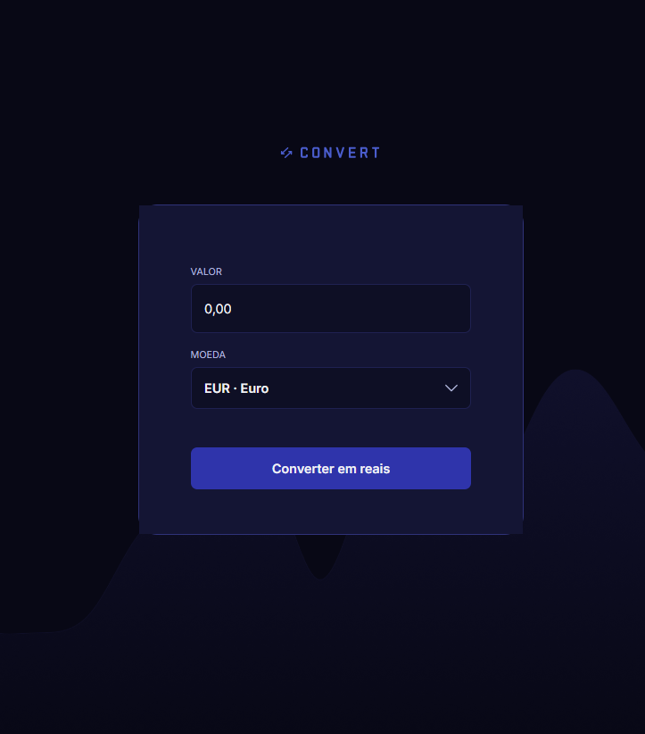

# 💱 Conversor de Moedas

Aplicação web para conversão de moedas com cotação de referência atualizada por API, desenvolvida com foco em uma experiência simples, rápida e responsiva.

## Sobre o projeto

O projeto foi desenvolvido de forma independente a partir de uma necessidade comum: consultar rapidamente quanto um valor em moeda estrangeira representa em reais. A solução permite informar um valor, escolher uma moeda e visualizar o total convertido em BRL, com atualização da cotação diretamente no navegador.

A implementação valoriza uma interação direta: o campo monetário segue o padrão brasileiro, o seletor apresenta código e nome de cada moeda e o resultado informa a data da taxa utilizada.



As cotações são consultadas na [Frankfurter API](https://frankfurter.dev/), uma API pública que reúne taxas de referência de bancos centrais. Elas são atualizadas em dias úteis e não representam uma cotação comercial em tempo real de compra ou venda.

## Funcionalidades

- Conversão de 15 moedas internacionais para real brasileiro (BRL)
- Seletor customizado de moedas com código, nome e rolagem
- Campo monetário no padrão brasileiro, preenchido da direita para a esquerda
- Consulta da cotação de referência pela API Frankfurter
- Exibição da cotação e da data de referência usadas no cálculo
- Formatação do resultado no padrão brasileiro
- Validação da entrada para aceitar somente números
- Estado de carregamento e tratamento de falha na consulta
- Layout adaptado para telas menores

## Tecnologias utilizadas

- HTML5
- CSS3
- JavaScript (ES6)
- [Frankfurter API](https://frankfurter.dev/)

## Como executar localmente

Não há dependências nem etapa de instalação. É necessário ter conexão com a internet para buscar as cotações.

1. Clone o repositório:

   ```bash
   git clone https://github.com/jpfreitas-dev/currency-converter.git
   ```

2. Acesse a pasta do projeto:

   ```bash
   cd currency-converter
   ```

3. Abra o arquivo `index.html` no navegador.

Para usar, informe o valor, selecione a moeda desejada e clique em **Converter em reais**.

## Estrutura do projeto

```text
currency-converter/
├── img/          # Imagens e ícones da interface
├── index.html    # Estrutura da página
├── scripts.js    # Lógica de conversão e validação
└── styles.css    # Estilos e responsividade
```

## Status do projeto

Concluído e disponível para uso como demonstração de uma aplicação front-end integrada a uma API externa.

## Aprendizados

- Manipulação do DOM com JavaScript
- Tratamento de eventos de formulário
- Validação básica de campos
- Formatação de valores monetários com `Intl.NumberFormat`
- Organização de uma interface responsiva com CSS
- Consumo de API com `fetch`, `async` e `await`
- Tratamento de carregamento e falhas de uma requisição HTTP

## Autor

Desenvolvido por [João Paulo Freitas](https://github.com/jpfreitas-dev).
